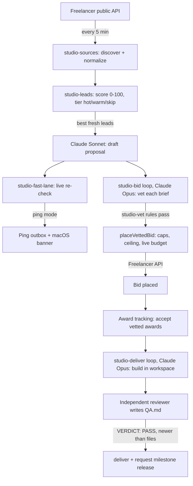

# Studio Operator

A freelance agent that finds small, well-scoped jobs on Freelancer.com, ranks them, drafts proposals with Claude, bids only on work it has vetted as finishable without a human, and then builds and delivers the won work behind an independent QA gate.

## Why

Freelance marketplaces reward speed: a good listing gets 80 to 200 bids within hours. Writing a decent proposal for each one by hand is slow, and most listings are a bad fit anyway (logo work, phone calls, "test task first", off-platform contact). Studio Operator does the triage and the first draft in minutes, and it keeps every action that touches money or a client behind hard, code-enforced limits instead of trusting the model's judgment.

## Features

- **Discovery** every 5 minutes through Freelancer's public projects API: targeted searches, deduplication, first-seen and last-seen timestamps, bid counts, rate-limit backoff.
- **Deterministic scoring (0–100)** from USD-converted budget, deliverable fit, bid count, freshness, language and brief quality. Out-of-scope work and red flags (off-platform contact, upfront fees, academic work, review manipulation) disqualify a listing.
- **Proposal drafting** with Claude Sonnet through the Claude Code CLI: no tools, no MCP servers, strict JSON schema, and a persona file (`config/persona.md`) that limits what the draft may claim. Capped at 3 drafts per tick and 30 per day.
- **Fast lane**: re-checks strong fresh drafts against the live listing and pings you while the listing is still open and uncrowded (≤ 8 h old, ≤ 30 bids).
- **Vet gate** (`studio-vet.mjs`): an unattended bid needs one of six autonomous delivery classes (static site, web component, script, data, writing, browser extension), autonomy ≥ 8/10, 2–12 testable acceptance criteria, ≤ 16 hours, 1–7 days, $40–$750, and a cover letter with no contact details. Vets expire after 6 hours.
- **API bidding with caps**: 2 bids a day, 6 a month, a $1,500 ceiling, fixed-price USD listings only, price inside the live budget. Repeated API refusals pause auto mode and then fall back to ping mode.
- **Award tracking**: accepts award offers on vetted bids (configurable) and hands won work to the delivery loop.
- **Delivery CLI** that owns every client-facing action: one workspace per job, a 6-messages-per-day cap per client, an off-platform contact filter, and a `deliver` command that refuses unless `QA.md` from an independent reviewer says `VERDICT: PASS`, ticks every acceptance criterion and is newer than every file being shipped. Then milestone release requests.
- **Studio pipeline** for manually added or won jobs: Opus brief analysis, economics (fees, contingency, margin), model routing with approval fingerprints, detached production workers with cancellation and orphan recovery, advisory QA, revisions, and a final human delivery gate.
- **Atomic, locked JSON stores** for every state file, with receipts kept for auditing.

## How it works



The repository has two kinds of code:

1. **Deterministic Node scripts** (`scripts/`) that own state, limits and every external call. They are plain ES modules with no npm dependencies.
2. **Agent loop specs** (`loops/specs/`) for the two Claude Opus loops. Each spec is a prompt with frontmatter for a scheduler (hourly). The model does the judgment (is this brief finishable alone, what are the acceptance criteria, build the deliverable), but it can only act through the CLIs, so the caps, the vet rules and the QA gate hold no matter what it decides.

A discovery tick is `node scripts/studio-sources.mjs`: refresh listings, run the lead pipeline, then run the fast lane. On the original machine it ran from a macOS LaunchAgent every 300 seconds.

## Tech stack

- Node.js 22.18+ (ES modules, `node:test`, built-in TypeScript type stripping for the two web tests)
- Claude Code CLI (`claude -p --json-schema`) for drafting, analysis, vetting and delivery, using Sonnet and Opus
- Freelancer.com REST API (public project reads; OAuth for bids, messages and milestones)
- macOS keychain (`security`) for the OAuth token, `osascript` for notifications (both optional)
- Next.js App Router + React + CSS modules for the dashboard excerpt in `web/`

## Getting started

```bash
git clone https://github.com/ianroyes-sys/studio-operator-freelance-agent.git
cd studio-operator-freelance-agent
cp .env.example .env            # all values are optional for a first look
npm test                        # 64 tests, no network, no model calls

npm run seed:example            # copy the fake fixtures in data/examples/ to data/studio/
node scripts/studio-bid.mjs status
node scripts/studio-fast-lane.mjs      # config, token state, caps
node scripts/studio-deliver.mjs list
```

Live discovery and drafting:

```bash
# Edit config/persona.md first: it is what the drafter is allowed to claim about you.
npm run discover                # one discovery tick (public API + drafts if the Claude CLI is installed)
node scripts/studio-fast-lane.mjs --dry
```

Turning on bidding (real money and contracts, so read `docs/releases/2026-10-26-bid-deliver-loops.md` first):

```bash
node scripts/studio-fast-lane.mjs set-token     # macOS keychain prompt, or set FREELANCER_OAUTH_TOKEN
node scripts/studio-fast-lane.mjs mode auto     # back off with: mode ping | mode off
```

Kill switches: a `STOP` file in the repo root, `data/studio/LEADS-PAUSED` (drafting) and `data/studio/FAST-LANE-PAUSED` (pings and bids).

Environment variables are listed in `.env.example`: `STUDIO_DATA_DIR`, `FREELANCER_OAUTH_TOKEN`, `STUDIO_PING_OUTBOX`, `STUDIO_CLAUDE_BIN`, `STUDIO_PERSONA_FILE`, plus `STUDIO_KEY`, `STRIPE_SECRET_KEY` and `STUDIO_QA_URL` for `web/`.

## Project structure

```
scripts/            Engine: one ES module per stage, each with a .d.mts type file and tests
  studio-sources.mjs    Freelancer discovery + the discovery tick entry point
  studio-leads.mjs      scoring, drafting, funnel (sent/won/lost), won-job conversion
  studio-fast-lane.mjs  live re-check, pings, capped API bidding, award tracking
  studio-vet.mjs        the rules an unattended bid must pass
  studio-bid.mjs        CLI for the bid loop: status, queue, vet, place, shortlist
  studio-deliver.mjs    CLI for the delivery loop: sync, inbox, send, deliver, release
  studio-store.mjs      job store, settings, economics, audit log
  studio-analysis.mjs   Claude Code runner + structured brief analysis
  studio-production.mjs / studio-autonomy.mjs / studio-router.mjs / studio-qa.mjs / studio-client.mjs
                        Studio pipeline: approval, workers, routing, QA, client drafts
  seed-example.mjs      copies the fake fixtures into the data directory
loops/specs/        Prompts for the hourly studio-bid and studio-deliver Claude loops
config/persona.md   Who the proposals are written for (edit this)
data/examples/      Fake *.sample.json fixtures (listings, leads, fast-lane, accounts)
docs/releases/      Release notes for the lead engine, fast lane and bid/deliver loops
web/                Next.js dashboard excerpt (see Status)
  app/api/studio/     API routes over the scripts (auth key + same-origin checks)
  components/studio/  Hot leads, opportunities, workflow, QA/delivery, client agent panels
  lib/                shared types, auth and account-evidence helpers
  qa/                 Playwright browser checks
  test/               auth and account-evidence tests
```

## Status

Built and run on my own machine from September to October 2026 as part of a larger private dashboard.

- **Running live:** discovery, scoring and proposal drafting against real Freelancer listings, and the fast-lane pings.
- **Built, tested against mocks only:** API bidding, award acceptance, client messages, attachment upload and milestone release. No bid has been placed through the API yet; that waits on a verified Freelancer account and OAuth token. The attachment upload field names are the least certain part.
- **No revenue so far.** The bottleneck has been account setup, not code.
- **`web/` is an excerpt, not a runnable app.** It was lifted out of the larger Next.js dashboard and has no `package.json`, layout or global styles of its own. It is here to show the UI and the API surface; to run it, drop `web/app`, `web/components` and `web/lib` into a Next.js 15 project with the `@/*` path alias pointing at the project root and `scripts/` alongside.
- A browser-automation lane for other marketplaces existed in the private version and is intentionally not part of this repository.

Built by [Ian Royes](https://github.com/ianroyes-sys)
